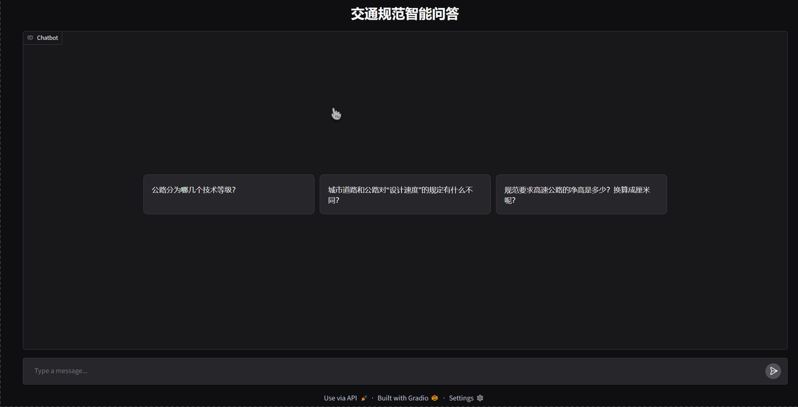

# traffic-agent

> 交通规范智能问答 Agent —— 一个会"自己查规范"的 RAG Agent

[English](README.md)

基于向量检索（ChromaDB）+ 大模型（DeepSeek）的交通规范问答系统。
给它一个规范问题，它会**自主检索相关条文**，并**带来源**作答。

## 能做什么

- **查条文**：问"公路用地范围怎么规定"，自动检索规范条文并作答
- **规范对比**：问"城市道路和公路的设计速度有什么不同"，对比两份规范
- **单位换算**：规范里的数值自动换算（如 5.00 m → 500 cm）
- **不编造**：条文里没有答案时，明确回答"没有找到相关规定"（防幻觉）

## 效果演示



## 评测故事：检索命中率 95% → 100%

RAG 的成败在检索——所以检索不是"感觉"，是**量出来的**。
用 20 道"问题 + 关键词"评测集（`docs/eval_set.json`）测"检索出的 top-3 里有没有答案"（`eval.py`，纯本地运行，不花 API 钱）：

| 阶段 | 检索命中率 |
|---|---|
| 基线（固定 300 字切块 + 60 字重叠） | **19/20（95%）** |
| 诊断 + 改进切分策略后 | **20/20（100%）** |

失败那道题的根因：含答案的块被**语义稀释**——前 40% 是上一节内容 + OCR 水印碎片（排名 184/246）。
修法（`rag/split_text.py`）：清噪声 + 在条文/子项边界"干净切"（不带走重叠尾巴）+ 只在长度强制切处保留重叠。
原来失败的那条现在排名第 1。复现：`python eval.py`

## 项目结构

```
traffic-agent/
├── config.py            # 配置中心（模型、检索参数、提示词）
├── main.py              # 命令行入口
├── app.py               # Gradio 网页界面（流式 + 工具日志 + 来源展示）
├── eval.py              # 检索评测（20 题 → 命中率）
├── agent/
│   └── agent.py         # Agent 核心（工具路由 + ReAct 主循环）
├── tools/
│   ├── search_tools.py  #   工具：查条文 / 规范对比
│   └── unit_tools.py    #   工具：单位换算
├── rag/
│   ├── store.py         #   向量库连接
│   ├── pdf_to_text.py   #   ① PDF → OCR → 文字
│   ├── split_text.py    #   ② 文字 → 切分（结构感知）
│   ├── build_index.py   #   ③ 切分 → 向量入库
│   └── search_test.py   #   ④ 检索测试
└── docs/                # 规范文本数据（OCR 提取 + 切分 + 评测集）
```

## 快速开始

```bash
git clone https://github.com/QRT5010/traffic-agent.git
cd traffic-agent

python -m venv .venv
source .venv/Scripts/activate        # Windows（Git Bash）；macOS/Linux 用 source .venv/bin/activate
pip install -r requirements.txt

cp .env.example .env                 # 编辑 .env，填入你的 DeepSeek API Key

# 构建向量库（在项目根目录运行；首次会下载约 100MB 向量化模型）
python rag/build_index.py            # chunks.json 已包含在仓库里；要重新生成先跑 rag/split_text.py

# 复现检索评测（纯本地，不需要 API Key）
python eval.py

# 启动网页界面 → http://127.0.0.1:7860
python app.py
```

> 国内网络：在命令前加 `HF_ENDPOINT=https://hf-mirror.com` 可加速模型下载。

## 数据来源

| 规范 | 来源 |
|---|---|
| 《城市道路交通工程项目规范》GB 55011-2021 | 住房和城乡建设部官网公开 |
| 《公路工程技术标准》JTG B01-2014 | 交通运输部官网公开 |

> 原始文件为**扫描版 PDF**，通过 `rag/pdf_to_text.py`（OCR）转为文字后入库。
> PDF 原文件不随仓库分发，提取出的文本在 `docs/` 下。

## 技术栈

Python 3.11 · DeepSeek API（OpenAI SDK）· ChromaDB · fastembed (bge-small-zh-v1.5) · RapidOCR · Gradio

## License

MIT
